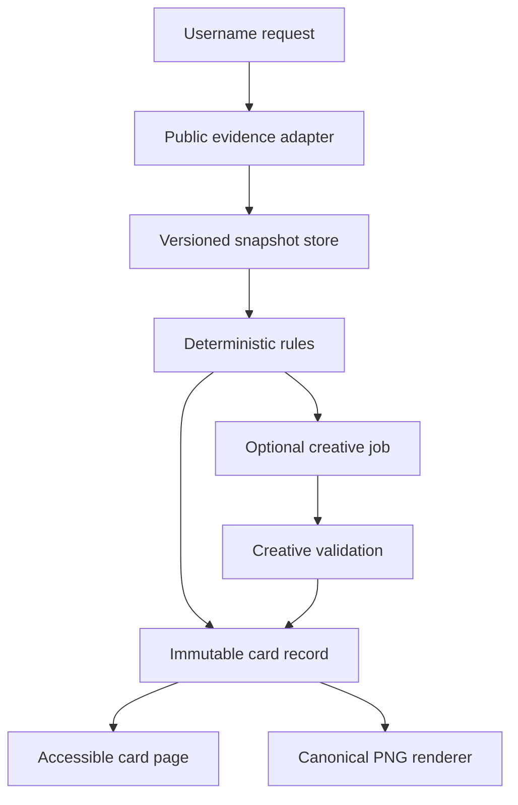

# Gitmancer — Evidence and Product Blueprint

Project: **Gitmancer**. Destination repository: [GadDev/gitmancer](https://github.com/GadDev/gitmancer). These choices were confirmed by the user after the original planning draft.

Prepared 25 November 2026. Scope: read-only source investigation and proposed design. No upstream repository changes, commits, PRs, deployments, application implementation, or live GitHub-profile integration tests were performed.

## Recommendation

Adapt GitFut's acquisition, caching, route, and export patterns. Replace its football scoring and presentation with a transparent fantasy-character engine. Recommended MVP: deterministic mechanics and template artwork, with optional AI-generated presentation behind the same typed card contract. Think of the rules engine as the referee and the model as the costume designer.

The recommendation is `[ASSUMPTION — confirm: A1, A2]`, not a user-selected architecture. Exact game balance remains unvalidated. A collection of character cards does not itself require a playable card game.

## 1. Requirements and decision ledger

| ID | Status | Meaning |
|---|---|---|
| R0 | STATED | Project name: Gitmancer. Destination: GadDev/gitmancer. Publishing these four planning documents is authorized; application implementation is not part of this task. |
| R1 | STATED | Personalized original fantasy cards for developer community members, based on GitHub activity; Magic: The Gathering inspiration. |
| R2 | STATED | Single public username first; member gallery and batch generation later. |
| R3 | STATED | Reproducible scoring/game balance; separate facts, derived values, and creative content. |
| R4 | STATED | Explicit formulas, thresholds, caps, examples; handle sparse/new/private/bot/fork/extreme profiles; avoid spam/popularity as ability. |
| R5 | STATED | Secure server token, refresh/cache/versioning, PNG, sharing, mobile accessibility, low-cost deployment proposal. |
| R6 | STATED | Read-only investigation and planning now, with source references and reuse/license analysis. |
| A1 | ASSUMPTION — confirm | Approach 2 with a complete deterministic fallback; optional AI presentation only. |
| A2 | ASSUMPTION — confirm | Adapt Next.js/TypeScript; canonical server PNG; single-host Node/Docker/SQLite pilot with optional Redis. |
| A3 | ASSUMPTION — confirm | Public-only 365-day UTC evidence; exact proposed aggregation, caps and normalization below. |
| A4 | ASSUMPTION — confirm | Contribution-based class/faction; stable cosmetic rarity independent of power/popularity. |
| A5 | ASSUMPTION — confirm | Small ability catalog, proposed stat/cost budget; collectible sheets until game scope is selected. |
| A6 | ASSUMPTION — confirm | Immutable snapshots/variants, latest pointer, 2-hour acquisition cache; last-complete fallback. |
| A7 | ASSUMPTION — confirm | Proposed phase order, modules, gates and tests. |
| A8 | ASSUMPTION — confirm | Original illustrated guild direction, serif names, parchment/ink/muted jewels, geometric emblems. |
| A9 | ASSUMPTION — confirm | Incomplete core evidence yields a provisional identity card with mechanics withheld, not zeroed. |
| A10 | ASSUMPTION — confirm | Proposed API/AI budgets, throttles and controlled enrichment; no paid generation on views. |

No blocking clarification was needed to produce this draft. Project name **Gitmancer** and destination **GadDev/gitmancer** are confirmed. Community, providers, budget and game scope remain open. The three companion documents are `constitution.md`, `roadmap.md`, and `techstack.md`; assumptions retain the same IDs everywhere.

## 2. Revision and inspection method

- Repository: [Younesfdj/gitfut](https://github.com/Younesfdj/gitfut).
- Default branch verified as `master`; reviewed commit: [`e1a3d80e207db727a2f664c82117ab5d2b771d59`](https://github.com/Younesfdj/gitfut/commit/e1a3d80e207db727a2f664c82117ab5d2b771d59).
- Complete recursive tree inspected; it was not truncated. No `AGENTS.md`, `.specify/`, or `openspec/` appears in that upstream tree. Applicable instructions supplied in the conversation were followed; no ancestor AGENTS file was found in the active workspace path.
- README, license, dependency manifest, Docker/config, GitHub client/token/signal/language code, scoring/awards, routes, card components, export/share code, and relevant tests were read at that SHA. This is static analysis, not proof of production behavior or measured performance.

### Verified architecture

[package.json, lines 13–35](https://github.com/Younesfdj/gitfut/blob/e1a3d80e207db727a2f664c82117ab5d2b771d59/package.json#L13-L35) declares Next.js 16.2.9, React 19.2.4, TypeScript 5, Tailwind 4, ioredis, html-to-image, sharp and Sentry; Vitest and Playwright are development dependencies. [next.config.ts, lines 4–23](https://github.com/Younesfdj/gitfut/blob/e1a3d80e207db727a2f664c82117ab5d2b771d59/next.config.ts#L4-L23) configures standalone output, external sharp, and the `/<username>.png` rewrite. The [Dockerfile, lines 1–38](https://github.com/Younesfdj/gitfut/blob/e1a3d80e207db727a2f664c82117ab5d2b771d59/Dockerfile#L1-L38) builds/runs a Node 22 standalone image as a non-root user.

### Verified end-to-end flow

1. The username form invokes the scouting flow; [ScoutForm.tsx, lines 62–90](https://github.com/Younesfdj/gitfut/blob/e1a3d80e207db727a2f664c82117ab5d2b771d59/components/ScoutForm.tsx#L62-L90) supplies an input and loading state. [useScout.ts, lines 33–57](https://github.com/Younesfdj/gitfut/blob/e1a3d80e207db727a2f664c82117ab5d2b771d59/hooks/useScout.ts#L33-L57) first checks browser storage, then fetches `/api/card/<login>`.
2. The [JSON route, lines 14–35](https://github.com/Younesfdj/gitfut/blob/e1a3d80e207db727a2f664c82117ab5d2b771d59/app/api/card/%5Busername%5D/route.ts#L14-L35) calls `scoutCard`, resolves optional country presentation, and maps invalid/notfound/ratelimit/config/other errors to 400/404/429/500/502.
3. [scout.ts, lines 94–115](https://github.com/Younesfdj/gitfut/blob/e1a3d80e207db727a2f664c82117ab5d2b771d59/lib/scout.ts#L94-L115) normalizes the cache key, serves tokenless sample cards for known sample names, checks Redis, and coalesces concurrent misses in a process-local map. [Lines 65–68](https://github.com/Younesfdj/gitfut/blob/e1a3d80e207db727a2f664c82117ab5d2b771d59/lib/scout.ts#L65-L68) run `fetchProfile → signalsFromPayload → buildCard → computeAwards → cache`.
4. [client.ts, lines 570–620](https://github.com/Younesfdj/gitfut/blob/e1a3d80e207db727a2f664c82117ab5d2b771d59/lib/github/client.ts#L570-L620) validates the username, selects a token, fetches GraphQL data, falls back to smaller contribution windows on resource errors, and fetches per-year history.
5. [signals.ts, lines 10–65](https://github.com/Younesfdj/gitfut/blob/e1a3d80e207db727a2f664c82117ab5d2b771d59/lib/github/signals.ts#L10-L65) derives the scoring input. [engine.ts, lines 172–229](https://github.com/Younesfdj/gitfut/blob/e1a3d80e207db727a2f664c82117ab5d2b771d59/lib/scoring/engine.ts#L172-L229) creates the football card, archetype and report; awards are added afterward.
6. The canonical username page reuses the `/u/<username>` page ([page.tsx, lines 1–6](https://github.com/Younesfdj/gitfut/blob/e1a3d80e207db727a2f664c82117ab5d2b771d59/app/%5Busername%5D/page.tsx#L1-L6)). That page calls request-memoized `loadCard` and renders the result ([page.tsx, lines 60–89](https://github.com/Younesfdj/gitfut/blob/e1a3d80e207db727a2f664c82117ab5d2b771d59/app/u/%5Busername%5D/page.tsx#L60-L89)). [ResultView.tsx, lines 173–199](https://github.com/Younesfdj/gitfut/blob/e1a3d80e207db727a2f664c82117ab5d2b771d59/components/ResultView.tsx#L173-L199) combines `PlayerCard`, tilt/presentation and actions.
7. Browser export uses `html-to-image` at pixel ratio 3, calling clone-based capture then downloading a PNG ([CardActions.tsx, lines 184–194](https://github.com/Younesfdj/gitfut/blob/e1a3d80e207db727a2f664c82117ab5d2b771d59/components/CardActions.tsx#L184-L194)). Capture waits for fonts/image decode, applies WebKit workarounds and removes its clone ([capture.ts, lines 142–219](https://github.com/Younesfdj/gitfut/blob/e1a3d80e207db727a2f664c82117ab5d2b771d59/lib/capture.ts#L142-L219)).
8. Separately, the [image route, lines 16–27](https://github.com/Younesfdj/gitfut/blob/e1a3d80e207db727a2f664c82117ab5d2b771d59/app/api/card-image/%5Busername%5D/route.tsx#L16-L27) gets the same card and calls a server `ImageResponse` renderer, with sharp avatar preprocessing. [renderCard.tsx, lines 211–219](https://github.com/Younesfdj/gitfut/blob/e1a3d80e207db727a2f664c82117ab5d2b771d59/lib/og/renderCard.tsx#L211-L219) outputs 810×1230 PNG with cache headers. It does not require stored card PNGs in the inspected path.
9. [share.ts, lines 31–65](https://github.com/Younesfdj/gitfut/blob/e1a3d80e207db727a2f664c82117ab5d2b771d59/lib/share.ts#L31-L65) builds username URLs and platform intents. [useShareActions.ts, lines 28–57](https://github.com/Younesfdj/gitfut/blob/e1a3d80e207db727a2f664c82117ab5d2b771d59/hooks/useShareActions.ts#L28-L57) handles native sharing and clipboard fallback; [CardActions.tsx, lines 103–119](https://github.com/Younesfdj/gitfut/blob/e1a3d80e207db727a2f664c82117ab5d2b771d59/components/CardActions.tsx#L103-L119) can attach a rendered image where file sharing is supported.

### Which data is actually collected?

| Input | Window / scope in inspected code | Important qualification |
|---|---|---|
| Login, name, avatar, location, creation date, followers | Current profile | Snapshot data; not identity verification. |
| Owned repository count and star inputs | `ownerAffiliations: OWNER`, `isFork: false`; first 100 ordered by stars | No cursor pagination. Node list is capped; the total count can exceed returned nodes. No explicit public visibility filter. |
| Commit, PR, review, issue, restricted contribution totals | Default `contributionsCollection`; fallback explicitly uses trailing 365 days | Normal query does not pass explicit dates. These are GitHub contribution measures, not every possible Git event. |
| Active days | Days with positive contribution-calendar counts | Can include shared restricted activity; not a public-only work calendar. |
| Language signals | Primary language of sampled owned repositories plus qualifying recently contributed public non-fork repositories | Not byte-weighted language expertise or actual languages edited. Up to 100 contributing repositories per queried window. |
| Lifetime and yearly totals | Account creation year (no earlier than 2008) through current year | Four years per query batch, then individual-year fallback. Failed years are omitted. |
| Special award windows | Tournament-specific dates for candidates only | An additional best-effort query path; irrelevant to the proposed fantasy MVP. |

Sources: [client.ts, lines 245–270](https://github.com/Younesfdj/gitfut/blob/e1a3d80e207db727a2f664c82117ab5d2b771d59/lib/github/client.ts#L245-L270), [434–512](https://github.com/Younesfdj/gitfut/blob/e1a3d80e207db727a2f664c82117ab5d2b771d59/lib/github/client.ts#L434-L512), [623–675](https://github.com/Younesfdj/gitfut/blob/e1a3d80e207db727a2f664c82117ab5d2b771d59/lib/github/client.ts#L623-L675), and [scout.ts, lines 72–87](https://github.com/Younesfdj/gitfut/blob/e1a3d80e207db727a2f664c82117ab5d2b771d59/lib/scout.ts#L72-L87).

### Verified scoring, beyond the README

Let `L(x)=log10(1+max(0,x))`. Initial stats are rounded and clamped to 1–99:

| Stat | Implemented initial formula |
|---|---|
| PAC | `36 + 12 L(recent contributions)` — not commits alone |
| SHO | `36 + 13 L(sampled owned stars) + 5 L(largest sampled repo stars)` |
| PAS | `40 + 12 L(recent PR contributions) + 9 L(followers)` |
| DRI | `58 + 7 sqrt(language count)` |
| DEF | `40 + 14 L(review contributions + issue contributions)` |
| PHY | `40 + 9 L(lifetime contributions) + 2.2 min(active_years,12)` |

These are intermediate values, not final displayed ratings. The engine computes a sigmoid magnitude center between 48 and 82 from stars/followers/lifetime/age; z-scores the six stats; applies antagonist-pair penalties; spreads around the center; pulls PAC/SHO/PAS/DRI toward their group mean with cohesion 0.6; assigns Forward/Playmaker/Anchor by pair totals; then computes the family-weighted overall capped at 88. A separate sigmoid legacy score adds up to 11, with final clamp 1–99. Finish tiers include silver at 65, gold at 75, TOTY at 85 with a legacy threshold, and icon at 90, plus special overrides. Sources: [engine.ts, lines 18–144](https://github.com/Younesfdj/gitfut/blob/e1a3d80e207db727a2f664c82117ab5d2b771d59/lib/scoring/engine.ts#L18-L144), [constants.ts, lines 22–42](https://github.com/Younesfdj/gitfut/blob/e1a3d80e207db727a2f664c82117ab5d2b771d59/lib/scoring/constants.ts#L22-L42).

The implementation also forces founder overalls of 93/91 and includes an icon allowlist ([constants.ts, lines 55–77](https://github.com/Younesfdj/gitfut/blob/e1a3d80e207db727a2f664c82117ab5d2b771d59/lib/scoring/constants.ts#L55-L77), [engine.ts, lines 178–188](https://github.com/Younesfdj/gitfut/blob/e1a3d80e207db727a2f664c82117ab5d2b771d59/lib/scoring/engine.ts#L178-L188)). These are intentional special cases, so the product is not uniformly statistics-only. They are not recommended for mechanical power in the new design.

### Authentication, caching and failures

- **Authentication:** server-only Bearer GraphQL requests. `GITHUB_TOKENS` overrides `GITHUB_TOKEN`; login hashing selects a token. Headers record quota health in Redis; rate-limited profile fetching can retry once with another token. [tokens.ts, lines 37–66](https://github.com/Younesfdj/gitfut/blob/e1a3d80e207db727a2f664c82117ab5d2b771d59/lib/github/tokens.ts#L37-L66), [client.ts, lines 157–220](https://github.com/Younesfdj/gitfut/blob/e1a3d80e207db727a2f664c82117ab5d2b771d59/lib/github/client.ts#L157-L220), [597–618](https://github.com/Younesfdj/gitfut/blob/e1a3d80e207db727a2f664c82117ab5d2b771d59/lib/github/client.ts#L597-L618).
- **Rate limits:** GraphQL is point-based, not a promise of 5,000 arbitrary requests/hour. Official [GitHub limits](https://docs.github.com/en/graphql/overview/rate-limits-and-query-limits-for-the-graphql-api) describe common 5,000 points/hour/user limits and secondary limits. Do not copy request-count comments as capacity estimates.
- **Timeout/retry:** each request uses an 8-second timeout; transient network/5xx/malformed JSON can retry once after 250 ms. A whole scout can make many requests and therefore exceed eight seconds. 403 and 429 are both treated as rate limits, which does not distinguish every possible permission failure. [client.ts, lines 153–240](https://github.com/Younesfdj/gitfut/blob/e1a3d80e207db727a2f664c82117ab5d2b771d59/lib/github/client.ts#L153-L240).
- **Partial results:** usable GraphQL user nodes with field errors are accepted. Recent resource-limit fallback halves windows twice; a still-failing floor window becomes empty/zero. Lifetime failures omit years. The returned payload lacks a comprehensive completeness flag. [client.ts, lines 238–240](https://github.com/Younesfdj/gitfut/blob/e1a3d80e207db727a2f664c82117ab5d2b771d59/lib/github/client.ts#L238-L240), [373–403](https://github.com/Younesfdj/gitfut/blob/e1a3d80e207db727a2f664c82117ab5d2b771d59/lib/github/client.ts#L373-L403), [497–512](https://github.com/Younesfdj/gitfut/blob/e1a3d80e207db727a2f664c82117ab5d2b771d59/lib/github/client.ts#L497-L512).
- **Cache layers:** built cards use versioned Redis keys for 2 hours; failures are not cached; missing/unavailable Redis falls back to live fetching. Process-local single-flight does not coordinate across server instances. Request-level React memoization deduplicates page/metadata calls. Browser localStorage lasts 3 hours and lacks scoring-version namespacing. Server PNG response headers allow browser caching for 1 hour, shared caching for 1 day, and stale-while-revalidate for 7 days. These layers can show different refresh times. [scout.ts, lines 24–63](https://github.com/Younesfdj/gitfut/blob/e1a3d80e207db727a2f664c82117ab5d2b771d59/lib/scout.ts#L24-L63), [118–130](https://github.com/Younesfdj/gitfut/blob/e1a3d80e207db727a2f664c82117ab5d2b771d59/lib/scout.ts#L118-L130), [useScout.ts, lines 6–14](https://github.com/Younesfdj/gitfut/blob/e1a3d80e207db727a2f664c82117ab5d2b771d59/hooks/useScout.ts#L6-L14), [renderCard.tsx, lines 211–219](https://github.com/Younesfdj/gitfut/blob/e1a3d80e207db727a2f664c82117ab5d2b771d59/lib/og/renderCard.tsx#L211-L219).

### Semantic traps to fix during adaptation

1. `issues_closed` is assigned `totalIssueContributions`, which measures issues **opened**. `prs_to_others` is assigned PR contribution totals without a repository-ownership filter proving the name. `recent_commits` includes the restricted contribution lump, which is not a private-commit count. [signals.ts, lines 57–63](https://github.com/Younesfdj/gitfut/blob/e1a3d80e207db727a2f664c82117ab5d2b771d59/lib/github/signals.ts#L57-L63); official [field definitions](https://docs.github.com/en/graphql/reference/users#contributionscollection).
2. The contributed-language threshold is described as three commits, but it checks `contributions.totalCount`. The official [commit aggregation schema](https://docs.github.com/en/graphql/reference/commits#commitcontributionsbyrepository) says each contribution represents a day. This is a threshold on contribution-day records, not a sum of their `commitCount` values. [client.ts, lines 644–649](https://github.com/Younesfdj/gitfut/blob/e1a3d80e207db727a2f664c82117ab5d2b771d59/lib/github/client.ts#L644-L649).
3. `active_years` counts distinct repository creation/push endpoint years, bounded by age. It is a proxy, not the number of years with recorded contributions. [signals.ts, lines 24–38](https://github.com/Younesfdj/gitfut/blob/e1a3d80e207db727a2f664c82117ab5d2b771d59/lib/github/signals.ts#L24-L38).
4. Summed top-100 stars are not necessarily all owned stars. Owned repository queries have no explicit public-visibility constraint. Reuse needs a clearly defined public data contract, not just labels saying “public.”
5. Redis TLS verification is explicitly disabled for `rediss://` in [redis.ts, lines 9–18](https://github.com/Younesfdj/gitfut/blob/e1a3d80e207db727a2f664c82117ab5d2b771d59/lib/redis.ts#L9-L18). Restore certificate validation/configured trust rather than carrying that deployment-specific setting forward.
6. [og/card.tsx, lines 4–6](https://github.com/Younesfdj/gitfut/blob/e1a3d80e207db727a2f664c82117ab5d2b771d59/lib/og/card.tsx#L4-L6) has an outdated comment about client images being stored in Blob; actual inspected routes render on demand. Route behavior takes precedence over that comment.

### Artwork and reuse/license assessment

Verified artwork path: static tier backgrounds in `public/cards`, an avatar, flags and language logos are composited; no AI-art generation call appears in the inspected generation/render path. [finishTheme.ts, lines 26–72](https://github.com/Younesfdj/gitfut/blob/e1a3d80e207db727a2f664c82117ab5d2b771d59/components/finishTheme.ts#L26-L72), [renderCard.tsx, lines 116–129](https://github.com/Younesfdj/gitfut/blob/e1a3d80e207db727a2f664c82117ab5d2b771d59/lib/og/renderCard.tsx#L116-L129). This does not establish how every upstream image was originally created.

The [MIT LICENSE, lines 3–13](https://github.com/Younesfdj/gitfut/blob/e1a3d80e207db727a2f664c82117ab5d2b771d59/LICENSE#L3-L13) permits reuse/modification subject to retaining its copyright and permission notice in copies/substantial portions. Retain that notice when copying code. The repository-level license is not evidence of ownership of every font, logo or third-party image; no separate font/art license files were found in the recursive tree. **Recommendation [ASSUMPTION — confirm: A2, A8]: reuse code patterns with attribution; supply original frames/art and fonts with verified licenses.**

| Upstream module | Proposed treatment [ASSUMPTION — confirm: A2, A7] |
|---|---|
| `lib/github/client.ts`, `tokens.ts` | Adapt validation, GraphQL transport and errors; explicit public filtering, pagination, completeness and one credential initially. |
| `lib/scout.ts`, `lib/redis.ts` | Adapt orchestration, versioned cache and deduplication; add durable snapshots and validated cache records; repair Redis TLS. |
| `lib/github/signals.ts` | Replace with accurately named, provenance-bearing public metrics. |
| `lib/scoring/*`, `lib/awards.ts`, founder/legacy overrides | Replace football formulas, trophy logic and privileged overalls with new catalog/rules. |
| `ScoutForm`, `CardActions`, share helpers | Adapt input/error/download/share UX and product copy. |
| `PlayerCard`, `finishTheme`, `lib/og/*` | Replace layout and assets; retain the server-rendering pattern and useful decode/fallback ideas. |
| `lib/capture.ts` | Optional compatibility fallback; canonical server export avoids making DOM capture the sole path. |
| `tests/client.test.ts`, `scout.test.ts` | Adapt transport/cache fixtures; change zero-on-missing expectations. Scoring tests need new fixtures. |

Existing tests cover cache coalescing and zero fallback ([scout.test.ts, lines 50–102](https://github.com/Younesfdj/gitfut/blob/e1a3d80e207db727a2f664c82117ab5d2b771d59/tests/scout.test.ts#L50-L102), [client.test.ts, lines 370–382](https://github.com/Younesfdj/gitfut/blob/e1a3d80e207db727a2f664c82117ab5d2b771d59/tests/client.test.ts#L370-L382)). They were inspected, not executed. No claim is made that upstream tests currently pass.

## 3. Three implementation approaches

The operational comparisons below are forecasts `[ASSUMPTION — confirm: A1]`, not measured benchmarks; actual latency and cost depend on implementation/provider. The factual reference point is GitFut's deterministic engine and existing server PNG path.

| Dimension | 1. Rules + templates | 2. Rules + optional AI presentation | 3. AI card design + validation |
|---|---|---|---|
| Reproducibility | Exact for fixed inputs/rule/assets | Mechanics exact; save creative outputs for exact re-display | Schema compliance alone does not ensure identical or balanced mechanics; must store outputs and validate semantic budgets |
| Creative variety | Bounded by authored asset/template catalog | Varied text and artwork without changing mechanics | Broad variation, including mechanics, with additional validation burden |
| Complexity | Baseline rules/render/data work | Baseline plus enrichment lifecycle, assets, budget and fallback | Adds mechanic interpretation, rejection/retry and much wider test surface |
| Operating cost | No model calls; hosting/API/storage still count | Baseline plus bounded text/image requests and asset storage | Variable generation/retry cost plus baseline |
| Latency | API/cache/render path | Same immediate template path; enrichment separately | Uncached completed design depends on generation and validation |
| Testing | Exact fixtures, invariants, render tests | Same plus creative-schema/fallback/provenance tests | Same plus adversarial and semantic rule validation; schema alone insufficient |

**Recommendation [ASSUMPTION — confirm: A1]: approach 2, built on a fully working approach-1 path.** Creative providers remain [OPEN]. An unavailable AI key must not prevent anyone from receiving a card. Approach 3 offers little value for an MVP whose requirement is reproducible mechanics; reassess only if creative mechanics become a product goal.

## 4. Proposed evidence and scoring contract

All numerical rules in this section are design proposals `[ASSUMPTION — confirm: A3, A4, A5, A9]`, not discovered GitFut rules or validated measures of developer quality.

### Acquisition and aggregation

- Fix `to` at acquisition time and `from = to − 365×24 hours`, in UTC; store both. No annualization for young accounts. GitHub-attributed contribution data is a partial view of work, even when a query completes.
- Fetch public commit contribution-day records, PR contributions, review contributions and opened-issue contributions. Filter `repository.isPrivate === false` on actual records; exclude restricted/inaccessible records rather than guessing their type. Never use `restrictedContributionsCount` to inflate commits. Explicitly public-filter repository metadata too.
- Paginate connection records with `pageInfo/endCursor`; sum commit records' `commitCount`, not connection `totalCount`. Fetch dates to calculate public active days from the union of public event UTC dates. Do not rely on the mixed-visibility calendar.
- Deduplicate records at window/page boundaries. PRs and issues count once by stable ID. Reviews count at most once per `(PR ID, reviewer ID, UTC date)`. Commit contribution records deduplicate by repository ID/day before summing; use GitHub's attribution rather than claiming SHA-level deduplication that these records cannot provide.
- Effective commits `c = sum_over_UTC_days(min(10, publicCommitCountForDay))`, across repositories. Keep raw and effective counts separately. PRs `p`, reviews `r`, issues opened `i`, and distinct public active days `d` retain their precise definitions.
- Authored work attributed by GitHub can count when a workflow involves a fork. Merely owning/forking a repository gives no power; no inherited stars, copied code volume, or repository count enters mechanics. Do not discard legitimate upstream PRs because development happened in a fork.
- Language/theme information is cosmetic; missing language metadata does not invalidate otherwise complete core metrics. Do not infer personality, ethnicity, gender, ability, or a formal maintainer role from a language or avatar.

Proposed bounded fetch policy `[ASSUMPTION — confirm: A10]`: at most 2 concurrent requests per generation; 8-second per-attempt timeout; one transient retry; at most 50 total HTTP attempts, 200 observed GraphQL points, and 60 seconds total acquisition time. These are protective configuration proposals, not GitHub limits or a response-time promise. Since per-query cost is only known after a response, reserve estimated headroom before dispatch and stop new work once a bound is reached. Apply reset/Retry-After backoff rather than immediately retrying throttled requests.

GitHub's contributing-repository list is bounded rather than a normal cursor connection. Compare returned coverage to API totals, split date windows when appropriate, and mark unresolved repository coverage partial. Bounded work may produce provisional cards for very large accounts; never advertise truncated data as a complete annual total. Missing pages, exhausted windows or field errors carry per-metric status/reasons. A failed profile lookup produces a user error; a confirmed profile with incomplete core evidence produces the A9 provisional branch.

### Normalization

For a nonnegative count `x`, define:

```text
N(x, cap) = floor(100 × log2(1 + min(x, cap)) / log2(1 + cap) + 0.5)

C = N(c, 255)     effective public commits
P = N(p, 63)      public PR contributions
R = N(r, 63)      deduplicated public review contributions
I = N(i, 31)      public opened-issue contributions
D = N(d, 127)     public active days
```

Validate counts as finite nonnegative integers; invalid data is an error, not coerced into zero. Scores are integers 0–100. The daily cap plus saturation bounds commit farming; neither proves intent or removes all gaming. Other contributions can also be gamed. No score measures quality or compares engineering ability. Stars, followers, account age and language count contribute **zero** mechanical points.

### Class, title and faction

Choose the largest of `R,P,C,I` with deterministic tie priority `R > P > C > I`. If all are below 40, use Wayfarer. The choices are fantasy metaphors, not claims that someone has repository permissions or a job title.

| Winning signal | Class | Deterministic title | Faction / original emblem | Palette |
|---|---|---|---|---|
| R | Guardian | Aegis Keeper | Bastion / split hexagon | Slate blue, silver |
| P | Weaver | Threadbinder | Confluence / interlaced arcs | Teal, ink |
| C | Artificer | Emberwright | Kiln / open diamond | Terracotta, charcoal |
| I | Pathfinder | Lantern Seeker | Lantern / three rays | Ochre, deep violet |
| No score ≥40 | Wayfarer | First Spark | Horizon / offset circle | Parchment, moss |

Template name: `<display name>, <title>`; use login when display name is empty. AI may suggest another presentation name without changing class/faction. Known language labels may theme tools and scenery, but never stats. Avoid automated likeness transformation; an abstract character illustration is sufficient.

### Power, toughness, abilities and resource cost

```text
power     = 1 + floor((3C + P) / 100)       // 1..5
toughness = 1 + floor((2R + I + D) / 100)   // 1..5
```

Each signal below unlocks its catalog ability at 40. Sort eligible abilities by corresponding normalized score descending, ties `R > P > C > I`, and take at most two. If none qualifies, take Spark. An ability is an ID with fixed application-owned text; the model cannot invent executable rules.

| ID / name | Signal | Fixed prototype text | Budget points |
|---|---|---|---|
| `aegis` / Aegis | R | The first time this unit would take damage each round, prevent 1 of that damage. | 2 |
| `relay` / Relay | On entry, another friendly unit gains +1 toughness until the end of this round. | 1 |
| `forge` / Forge | On entry, deal 1 damage to one opposing unit, if any. | 1 |
| `survey` / Survey | On entry, look at your deck's top card; you may put it on the bottom. No effect on an empty deck. | 1 |
| `spark` / Spark | On entry, restore 1 vitality to your player, up to starting vitality. | 1 |

```text
abilityPoints = sum(points for selected abilities)   // at most 3
budget = power + toughness + abilityPoints          // at most 13
resourceCost = ceil(budget / 2)                     // 2..7
```

Charge is the proposed generic resource, replacing copied mana symbols. Higher attributes pay a higher cost; rarity never adds stats or abilities. Catalog costs are balancing hypotheses, not proof of competitive fairness. For interpreting prototype text, a unit is a deployed card; a round is one turn for each player; vitality means player health. Deck construction, resource economy, starting vitality, combat and victory rules remain [OPEN]. The MVP renders cards without implementing a battle system; a playable game needs a separate rules document and playtesting.

### Rarity without popularity ranking

Proposed cosmetic rarity `[ASSUMPTION — confirm: A4]`:

```text
digest = SHA256(UTF8("community-v1:" + stableGitHubUserId))
bucket = unsigned_big_endian_integer(first 8 digest bytes) mod 100
0..59 Common; 60..84 Uncommon; 85..96 Rare; 97..99 Astral
```

These are approximate distribution weights, not a count of actually minted cards. The stable account ID and fixed collection salt keep rarity unchanged by username edits, refreshes, activity and scoring updates. No reroll endpoint. A newcomer can receive Astral; a famous developer can receive Common. Cosmetic rarity is presented as a finish, with “not a developer rank” next to its explanation. It is neither scarcity nor a transferable asset.

### Missing data, new profiles and bots

| Situation | Proposed behavior [ASSUMPTION — confirm: A3, A9] |
|---|---|
| Complete metrics, zero activity | Valid Wayfarer, 1/1, Spark, cost 2; neutral copy, no “bad developer” label. |
| New account | Count observed activity as-is; show account creation/window coverage. No annualized boost or age penalty. |
| Private work unavailable | Public-only explanation. Do not infer zero private work or assign private totals to activity types. |
| Missing core page/window or field | `partial/unavailable` status; withhold mechanics on provisional identity card, or show a labeled last-complete snapshot. |
| Missing cosmetic language/art | Deterministic neutral artwork; mechanics may remain available. |
| Confirmed bot account | Distinct automaton identity with mechanics withheld in the human community MVP. Query account type; suffix/name clues alone are insufficient. |
| Very high activity | Daily caps and saturation apply; query-budget exhaustion is partial, never fabricated zero. |
| Forks | Reward attributed contributions, not possession of fork metadata or inherited stars. |

## 5. Three fictional profiles and fully calculated cards

All names, account IDs, counts, biographies and card text here are fabricated fixtures. They are not observations about GitHub users. The calculations and rarity buckets were independently recomputed with Python during this planning task.

| Fixture | Mira — newcomer | Rowan — collaborative maintainer persona | Ivo — prolific specialist |
|---|---:|---:|---:|
| Fictional stable ID | `FICTIONAL_001` | `FICTIONAL_002` | `FICTIONAL_003` |
| Account age (context only) | 30 days | 5 years | 3 years |
| Raw public commit count | 3 | 63 | 4,095 |
| Effective commits after daily cap | 3 | 63 | 630 |
| PR contributions | 1 | 31 | 7 |
| Deduplicated review contributions | 0 | 63 | 0 |
| Opened-issue contributions | 0 | 15 | 1 |
| Public active days | 3 | 127 | 63 |
| C, P, R, I, D | 25, 17, 0, 0, 29 | 75, 83, 100, 80, 100 | 100, 50, 0, 20, 86 |
| Class / faction | Wayfarer / Horizon | Guardian / Bastion | Artificer / Kiln |
| Abilities and points | Spark (1) | Aegis (2), Relay (1) | Forge (1), Relay (1) |
| Power / toughness | 1 / 1 | 4 / 4 | 4 / 2 |
| Budget / resource cost | 3 / 2 | 11 / 6 | 8 / 4 |
| Rarity bucket / finish | 5 / Common | 64 / Uncommon | 61 / Uncommon |

Ivo's fictional raw commits are spread across 63 days, each with at least ten commits, giving `63×10=630` after the daily cap. The other fixtures do not exceed ten commits on any day. Active days include the union of public contribution types, so Rowan's 127 days are consistent with the fixture's event totals.

**Mira, First Spark — 2 Charge, 1/1, Common.** `N(3,255)=25`, `N(1,63)=17`, `N(3,127)=29`. Power `1+floor((75+17)/100)=1`; toughness `1+floor(29/100)=1`; cost `ceil((1+1+1)/2)=2`. No class/ability signal reaches 40; Spark applies. Flavor: “Every enduring forge begins with a careful spark.” Art direction: a traveler sheltering a tiny geometric ember, parchment sky and moss-green cloak.

**Rowan, Aegis Keeper — 6 Charge, 4/4, Uncommon.** `N(63,255)=75`, `N(31,63)=83`, `N(63,63)=100`, `N(15,31)=80`, `N(127,127)=100`. Power `1+floor((225+83)/100)=4`; toughness `1+floor((200+80+100)/100)=4`; strongest eligible abilities R then P; cost `ceil((4+4+2+1)/2)=6`. Flavor: “The city sleeps because someone checks the gates.” Art direction: a blue-silver guardian repairing a translucent ward with other travelers nearby. The persona reflects observed review activity, not verified maintainer permissions.

**Ivo, Emberwright — 4 Charge, 4/2, Uncommon.** Effective commits saturate C at 100; `N(7,63)=50`, `N(1,31)=20`, `N(63,127)=86`. Power `1+floor((300+50)/100)=4`; toughness `1+floor((0+20+86)/100)=2`; C then P gives Forge/Relay; cost `ceil((4+2+1+1)/2)=4`. Flavor: “One instrument, a thousand careful variations.” Art direction: a terracotta-cloaked smith shaping one precise crystalline tool. More raw commits beyond saturation add no power.

These distinct silhouettes illustrate the design goal; they do not validate matchup balance. None gains power from stars, followers or rarity.

## 6. MVP user journey and architecture

Proposed flow `[ASSUMPTION — confirm: A1, A2, A6, A8, A9, A10]`:

1. Enter a public GitHub username. Explain what public data is used.
2. Validate and fetch/cache a public evidence snapshot. Distinguish not-found, upstream outage, throttling and incomplete data.
3. Build a template card immediately after acquisition completes, or a clearly marked provisional card. Show the data timestamp and an expandable “Why this card?” view with source counts, derived scores and rule version.
4. Download canonical PNG, copy its immutable URL, or use native sharing where supported.
5. If optional enrichment is enabled for this deployment, an authorized generation action creates a saved creative variant. Ordinary views never generate paid content. Template fallback remains usable.
6. Refresh reuses fresh cached evidence; stale evidence triggers a bounded acquisition and creates a new card only if the canonical inputs/output change. Existing card URLs remain fixed.



### Module and storage boundaries

- **Data adapter:** receives username/window/credential internally; returns typed public counts, coverage and provenance. Credentials never enter its public return value. Raw text from GitHub is untrusted data, never an instruction to an AI provider.
- **Rules engine:** pure snapshot + scoring/catalog version → derived attributes. It has no token, network, model or current-time dependency; acquisition timestamps are passed in, not read implicitly.
- **Creative adapter:** receives a minimal sanitized descriptor (class/faction/theme and optional display name), not repository source code or private details. Returns only bounded text/art direction. A server-owned image adapter stores image bytes under an asset ID, rather than trusting model-returned remote URLs.
- **Snapshot store:** normalized counts, coverage, timestamps and input hash; immutable card records reference evidence and rules versions. Generated text/image outputs are persisted rather than regenerated from a seed. A model seed is not a guarantee of identical results.
- **Renderer:** consumes validated card JSON and approved assets. Renders text itself, uses original vector emblems, and displays rarity text as well as color. AI artwork contains no required type, cost, numbers or ability text.
- **Proposed persistence:** SQLite on a persistent volume for JSON records/latest pointers/jobs, approved assets on a backed-up directory; optional Redis for shared cache/locks when needed. Serverless is an alternative requiring external durable storage. Retention/deletion duration remains [OPEN].

### Typed contract (proposed, not implementation)

```ts
type Evidence<T> =
  | { status: "complete"; value: T }
  | { status: "partial" | "unavailable"; value: T | null; reason: string };
type Axis = "C" | "P" | "R" | "I" | "D";
type AbilityId = "aegis" | "relay" | "forge" | "survey" | "spark";
type Rarity = "Common" | "Uncommon" | "Rare" | "Astral";
type Faction = "Bastion" | "Confluence" | "Kiln" | "Lantern" | "Horizon";
type Archetype = "Guardian" | "Weaver" | "Artificer" | "Pathfinder" | "Wayfarer";
interface DeveloperCard {
  schemaVersion: "card-1";
  cardId: string;
  rules: { scoring: "guild-1"; catalog: "abilities-1"; collection: "community-v1" };
  identity: { githubUserId: string; login: string; displayName: string };
  evidence: {
    window: { from: string; to: string };
    fetchedAt: string;
    visibility: "public";
    quality: "complete" | "partial";
    rawCommits: Evidence<number>;
    metrics: Record<"commits" | "prs" | "reviews" | "issuesOpened" | "activeDays", Evidence<number>>;
    themeLanguage: Evidence<string | null>;
    warnings: string[];
  };
  derived: null | {
    scores: Record<Axis, number>;
    archetype: Archetype;
    faction: Faction;
    power: number;
    toughness: number;
    resourceCost: number;
    abilities: AbilityId[];
    rarity: Rarity;
  };
  creative: {
    source: "template" | "ai";
    name: string;
    flavorText: string;
    art: { kind: "template" | "generated"; assetId: string };
    provenance: {
      templateVersion: string;
      promptVersion?: string;
      provider?: string;
      model?: string;
      generatedAt?: string;
    };
  };
  renderVersion: "frame-1";
}
```

Runtime validation additionally enforces integer ranges, known IDs, at most two distinct abilities, exact recomputation of cost/stats, null mechanics for incomplete core data, bounded strings, and approved asset IDs. `quality` refers to core scoring evidence; cosmetic completeness is per-field. For a bot identity/provisional branch, `derived` is null. Public payloads exclude credentials and private records.

Example JSON below is the fictional Rowan template card. The card ID is SHA-256 of the canonical UTF-8 JSON body excluding `cardId` (recursive key ordering, no extra whitespace); the production canonicalization spec must be identical across writers. Rule, template, asset and render versions are included. This is an illustrative proposed schema, not a new application implementation.

```json
{
  "cardId": "febe30fbbabe5e3c51958ce9bdf7bc0f297c30306705f2fdb8b5afeb37615232",
  "schemaVersion": "card-1",
  "rules": {
    "scoring": "guild-1",
    "catalog": "abilities-1",
    "collection": "community-v1"
  },
  "identity": {
    "githubUserId": "FICTIONAL_002",
    "login": "fictional-rowan",
    "displayName": "Rowan"
  },
  "evidence": {
    "window": {
      "from": "2025-11-25T00:00:00Z",
      "to": "2026-11-25T00:00:00Z"
    },
    "fetchedAt": "2026-11-25T00:00:00Z",
    "visibility": "public",
    "quality": "complete",
    "rawCommits": {
      "status": "complete",
      "value": 63
    },
    "metrics": {
      "commits": {
        "status": "complete",
        "value": 63
      },
      "prs": {
        "status": "complete",
        "value": 31
      },
      "reviews": {
        "status": "complete",
        "value": 63
      },
      "issuesOpened": {
        "status": "complete",
        "value": 15
      },
      "activeDays": {
        "status": "complete",
        "value": 127
      }
    },
    "themeLanguage": {
      "status": "complete",
      "value": "TypeScript"
    },
    "warnings": []
  },
  "derived": {
    "scores": {
      "C": 75,
      "P": 83,
      "R": 100,
      "I": 80,
      "D": 100
    },
    "archetype": "Guardian",
    "faction": "Bastion",
    "power": 4,
    "toughness": 4,
    "resourceCost": 6,
    "abilities": [
      "aegis",
      "relay"
    ],
    "rarity": "Uncommon"
  },
  "creative": {
    "source": "template",
    "name": "Rowan, Aegis Keeper",
    "flavorText": "The city sleeps because someone checks the gates.",
    "art": {
      "kind": "template",
      "assetId": "bastion-guardian-01"
    },
    "provenance": {
      "templateVersion": "names-1"
    }
  },
  "renderVersion": "frame-1"
}
```

### Cache, URLs, refresh and failures

Proposals `[ASSUMPTION — confirm: A6, A9, A10]`:

- Acquisition cache: normalized login + public visibility + adapter version; 2-hour TTL. Card building cache: snapshot hash + scoring/catalog versions. Creative cache/job key: mechanic identity + prompt/provider/model/template versions; save actual output bytes.
- Persist the snapshot/card transaction before returning `/cards/<cardId>`. `/u/<login>` resolves the latest complete card, or explicitly shows a provisional result. Use stable GitHub ID to retain identity across renames; alias policy remains an implementation detail to specify.
- `/cards/<cardId>.png` renders exactly that immutable record. Cache it for one year as immutable; latest-page/latest-pointer responses use short revalidation, not immutable headers. Bumping `renderVersion` creates a distinct card/render key.
- Proposed export size 1000×1400; landscape social preview 1200×630 containing the same card. Match preview/export through shared layout constants and font metrics. The authoritative PNG can be embedded as the page's card image, with semantic HTML evidence alongside it.
- Coalesce identical acquisitions/jobs. Start single-instance; multiple instances need a shared lock with expiry and idempotent writes, since GitFut's map is only process-local.
- If GitHub fails, show a labeled last-complete card with age, or a retryable error if none exists. A partial refresh never overwrites the latest complete pointer. Invalid usernames return 400, missing users 404, known rate limits 429 with an appropriate recovery hint; service outages 502/503. An expired token is an operator configuration fault, not “user not found.”
- A provisional downloadable image visibly says “Partial public data — mechanics pending”; never substitute 0 for unknown. A standalone error image must not be cached as a successful permanent card.
- Guard arbitrary-username generation with proposed per-client throttle 5 new acquisitions/minute, bounded global concurrency and server-checked enrichment authorization. View/share/image GETs read stored cards; they cannot trigger paid model calls. Exact throttle calibration is a pilot decision.

### Creative and mobile design

Proposals `[ASSUMPTION — confirm: A8]`: parchment/ink base, muted faction accents, serif name, custom geometric guild symbols, original illustration pane, clear ability box, Charge pips with numeric label, power/toughness plaque, small evidence timestamp/version. Avoid copied card frames, logos, mana glyphs and named characters. Use original assets and documented font licenses.

Support keyboard generation/download/copy; announce loading/errors; provide a readable text card equivalent, sufficient contrast, non-color rarity/faction labels, reduced-motion behavior and responsive controls. At 320px width, controls must not overflow; long names wrap/shrink within tested limits without hiding mechanics. Export images are not a substitute for accessible HTML. Proposed input limits: display name 60 characters, generated name 72, flavor 180; font glyph fallback needs verification.

### Deployment and operating cost

Recommendation `[ASSUMPTION — confirm: A2]`: for a small pilot, use a Node-capable persistent host running Docker, SQLite and a backed-up asset directory; Redis is optional. An existing host may avoid an additional hosting purchase, but running it still consumes resources. A rented host, backups, domain or managed storage can incur recurring costs. No current vendor quote or free-tier eligibility is asserted. A serverless option requires external database/object storage and a separate plan/price check when selected.

No paid AI service is required for the complete deterministic MVP. AI enrichment adds the selected providers' text/image charges and asset storage; providers, models and prices are [OPEN]. Budget using measured pilot values:

```text
monthly cost = hosting + durable storage/backups + egress
             + enrichedCards × (meanTextCost + meanImageCost + meanRetryCost)
```

Count cold acquisitions, actual GraphQL points, image render duration, failures and enrichment spend. Do not equate views with generations or promise a latency without measurements. Proposed AI limit `[ASSUMPTION — confirm: A10]`: one text attempt plus one repair, one image attempt per authorized enrichment job, explicit administrator-set monthly cap, and deduplicated jobs. Provider polling/timeouts must be bounded; failure retains the saved template variant.

## 7. Implementation plan and meaningful acceptance tests

The phase sequence, file assignments and gates are recommendations `[ASSUMPTION — confirm: A7]`; see `roadmap.md` for the full phased plan. The brief authorizes this plan, not application changes.

| Phase | Key module work | Exit evidence |
|---|---|---|
| Public data | Adapt `lib/github/client.ts`; add `publicSnapshot.ts`, `pagination.ts`, `types.ts` | Correct paginated counts and completeness, no private leakage |
| Rules | Replace football engine with `lib/cards/{normalize,rules,catalog,identity,schema,build}.ts` | Exact fictional fixtures; invariants; explicit partial branch |
| Card/export/share | Add `FantasyCard`, `CardFrame`, `CardEvidence`, `lib/render/cardTree.tsx`, snapshot store and immutable routes; adapt form/actions/share/orchestration | Same saved record on page, PNG and shared URL |
| Optional AI | Add `lib/creative/{provider,templates,validate}.ts` and bounded jobs | Provider failures/invalid fields never change mechanics |
| Pilot | Deployment config, metrics, backups, asset notices | Measured limits, restore check, mobile/export review |
| Later | Gallery and batch, order [OPEN] | Membership/publication and paced job behavior designed before release |

| Test | Meaningful assertion |
|---|---|
| Formula golden fixtures | Mira = scores 25/17/0/0/29, 1/1 cost 2; Rowan = 75/83/100/80/100, 4/4 cost 6; Ivo = 100/50/0/20/86, 4/2 cost 4. Exact ability ordering and rarity buckets 5/64/61. |
| Boundaries and saturation | `N(0)=0`, cap maps to 100; invalid numbers rejected; above-cap commits/stars/followers do not create higher mechanics. Stats 1–5, cost 2–7, at most two abilities, cost equals budget formula. |
| Tie behavior | Equal R/P/C/I uses R→P→C→I; ability eligibility is inclusive at 40; 39 does not unlock. |
| Daily aggregation | 1,000 commits on one UTC day yields effective 10, not 1,000; ten commits on ten days yields 100. Sum `commitCount`; three records are not automatically three commits. |
| Pagination/dedup | A two-page fixture contributes each PR/issue ID once; repeated review same PR/user/day once; adjacent split windows do not double-count a day record or public active date. |
| Privacy/filtering | Inserting private/restricted nodes changes no public mechanics and exposes no private metadata; public fork-based PR work remains attributable without inherited star bonuses. |
| Sparse versus unknown | Confirmed complete zero → valid Wayfarer/Spark card; missing review page → null mechanics and visible provisional status. Neither is confused with notfound. |
| Language and account age | Missing cosmetic language does not suppress complete mechanics; age and popularity changes have no mechanical effect. |
| API failures | 401/config, notfound, permission 403, primary/secondary throttles, malformed/partial GraphQL, resource failure, reset/backoff and bounded retry each follow the correct state; total work is bounded. |
| Cache/concurrency | Case variants deduplicate; expired cache refreshes; rules-version bump rebuilds; partial/error cannot overwrite latest complete; identical concurrent writes remain idempotent. |
| AI isolation | Unknown ability IDs or model-supplied mechanics rejected; empty/overlong fields, provider timeout/budget exhaustion use templates. Saved creative output renders without another provider call. |
| Snapshot integrity | Same canonical body gives same cardId; changed body/version gives new ID; old links preserve saved content after refresh or AI enrichment. |
| PNG | Decode saved PNG and assert 1000×1400 and nonblank render; long names, missing art, Unicode glyphs and two-ability layout remain readable. Same mechanics/name/version as card JSON; font/image failures use known fallback. |
| Accessibility | Keyboard form/actions, loading/error announcements, 320px viewport, reduced motion, text alternatives and non-color labels verified in a browser. |
| Operations | Repeated GET view/embed causes zero model requests; secret-canary never appears in JSON/logs/PNG; durable snapshots/assets survive process restart and restore. |

Verification performed for this document: static source tracing; independent Python arithmetic and hash-bucket checks for the three fictional examples. Upstream tests, application builds, API authentication/rate-limit integration, image generation, actual card rendering, mobile UX and gameplay balance were **not** tested. Proposed acceptance tests above are future work, not claimed results.

## Open decisions

- [OPEN] Community and delivery schedule. Project name Gitmancer and repository GadDev/gitmancer are confirmed.
- [OPEN] Collectible sheets or eventual playable game; full combat/economy/deck rules and playtest targets.
- [OPEN] Adopt/revise formula caps, archetypes, ability budgets, rarity model and art direction.
- [OPEN] Hosting, persistent storage, driver/validation library, backup/retention/deletion policy, and operating budget.
- [OPEN] AI providers/models, generation authorization and budget; no provider is necessary for the template path.
- [OPEN] Gallery/batch order, member publication/removal preferences, and any later private-count display.

## Assumptions to confirm

- A1: approach 2 built on deterministic templates; model restricted to presentation.
- A2: proposed adapted Next.js/TypeScript, server PNG, Node/Docker/SQLite and optional Redis stack.
- A3: public-only explicit 365-day windows, aggregation, caps, normalization and deduplication.
- A4: contribution-based class/faction and stable cosmetic hash rarity.
- A5: prototype catalog/cost budget; no claim of validated playable balance.
- A6: immutable records/variants, latest pointers, 2-hour acquisition cache and proposed URL/export sizing.
- A7: phase ordering, module assignments, pilot and acceptance gates.
- A8: original guild visual direction, text limits, accessible layouts and abstract artwork.
- A9: incomplete data and bot behavior with mechanics withheld; last-complete fallback.
- A10: proposed query/throttle/enrichment budgets, authorization and no paid generation from views.