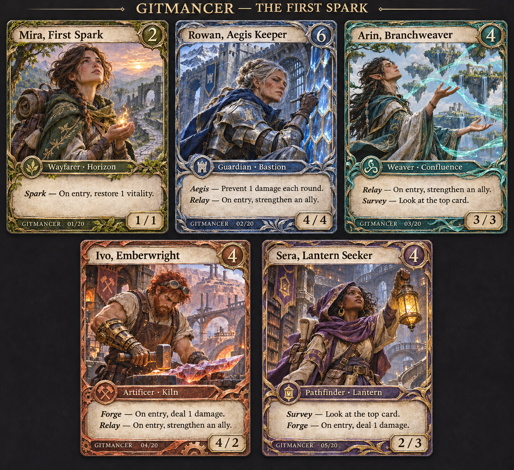
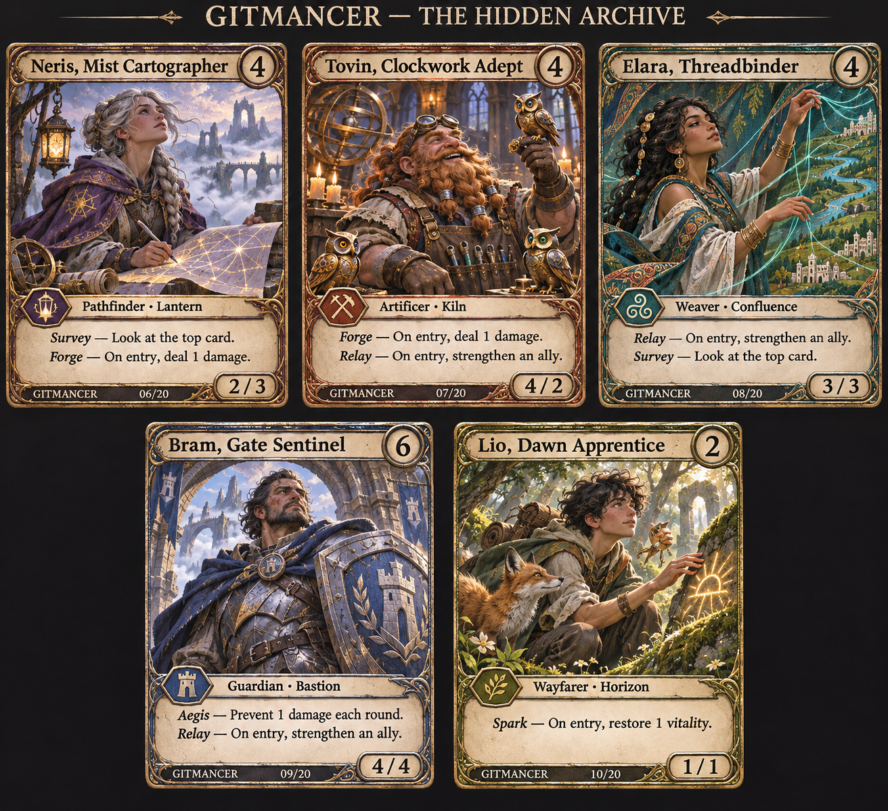
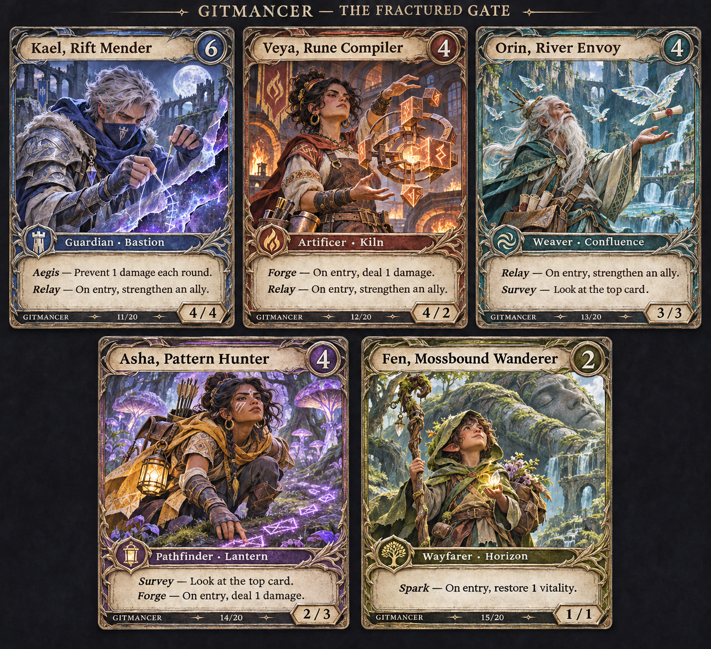
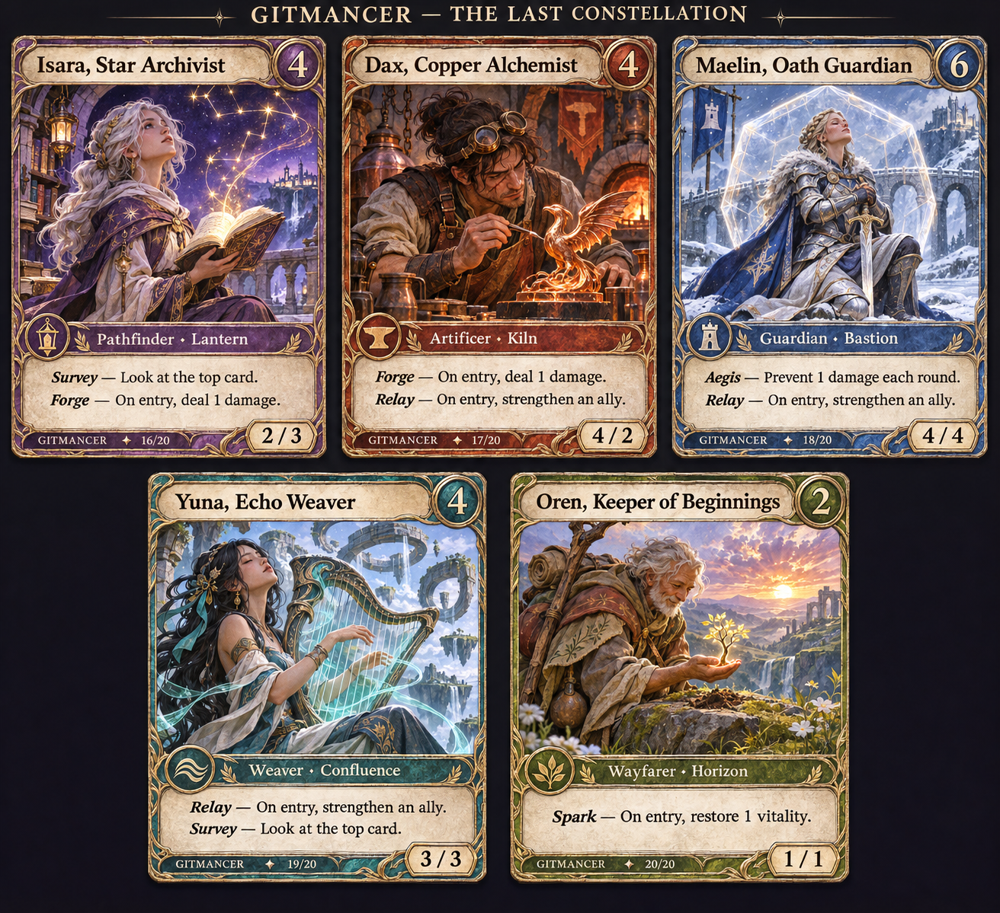

# Gitmancer — Illustrated concept collection

Twenty fictional fantasy cards, numbered 01–20, across four five-card sheets. These are AI-generated visual concepts, not cards derived from real GitHub profiles. The PNGs preserve the original generated sheets.

The current app continues to use deterministic template rendering. These sheets have not yet been connected to that renderer; their baked-in names, numbers and abbreviated ability text must not be used as the source of live game mechanics. For integration, use separate character artwork and application-rendered text sourced from validated card JSON.

## The First Spark — cards 01–05

## The Hidden Archive — cards 06–10

## The Fractured Gate — cards 11–15

## The Last Constellation — cards 16–20

## Next implementation steps

1. Prepare separate character illustrations and original reusable frames, without baked-in names or stats.
2. Map artwork choices to the five guilds while keeping the scoring engine authoritative.
3. Reuse the same assets and layout rules for the browser card and canonical PNG export.
4. Configure a server-side GitHub credential and verify live profiles, including sparse, private-work and very active accounts.
5. Deploy the single-host app with persistent SQLite storage, backups and an explicit public origin.
